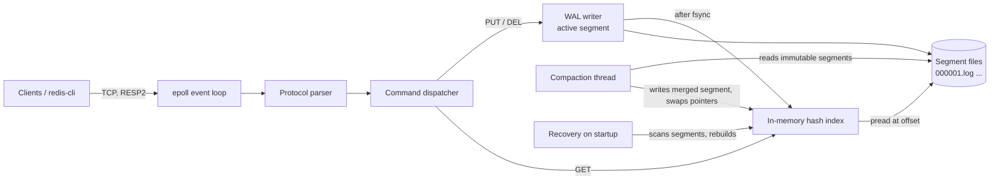

# tinykv: Requirements & Build Specification

A durable, single-node key-value store written in C. Writes go to an append-only write-ahead log (WAL), an in-memory hash index maps keys to log offsets, the store recovers cleanly after crashes, and old log segments are compacted in the background. Clients talk to it over TCP through a single-threaded `epoll` event loop.

The design is in the Bitcask family (the storage model behind Riak), which keeps the scope achievable while still touching the hard parts of storage engineering: on-disk formats, `fsync` semantics, torn writes, recovery, and concurrency during compaction.

---

## 1. Goals and non-goals

**Goals**

- Every write the server acknowledges survives a process crash (`kill -9`) when running in the default durability mode.
- Recovery after a crash is automatic, detects torn or corrupted records, and never serves a corrupted value.
- Disk usage stays bounded under overwrite-heavy workloads thanks to compaction.
- The server handles hundreds of concurrent clients on one thread with non-blocking I/O.
- The codebase is clean, tested, leak-free under Valgrind, and understandable by a reviewer in about 30 minutes.
- It speaks a subset of the Redis protocol (RESP2), so `redis-cli` and `redis-benchmark` work against it out of the box. This makes demos and benchmarking far easier.

**Non-goals** (state these explicitly in the README; knowing what you left out is a strength)

- Replication, clustering, or sharding.
- Transactions, range queries, or ordered iteration (a hash index can't do these efficiently; an LSM-tree or B-tree would).
- Datasets whose *key set* doesn't fit in RAM. Values live on disk; keys and index entries live in memory.
- Authentication and TLS (can be a stretch goal).
- Windows or macOS support. Linux only, because of `epoll`.

---

## 2. Architecture



**Write path:** parse command → encode record → append to active segment → `fsync` according to the durability policy → update index → reply to client. The reply is only sent after the data is durable (in `always`/`batch` modes).

**Read path:** look up key in index → `pread()` the record from the segment file at the stored offset → verify CRC → return the value.

---

## 3. Functional requirements

### 3.1 Data model

| Property | Requirement |
|---|---|
| Keys | Binary-safe byte strings, 1 to 1024 bytes |
| Values | Binary-safe byte strings, 0 to 1 MiB (configurable limit) |
| Namespace | Single flat keyspace |
| Deletion | Implemented as a tombstone record in the log |

### 3.2 Client protocol (RESP2 subset)

Requests arrive as RESP arrays of bulk strings (what `redis-cli` sends). Supporting inline commands (`PING\r\n`) is optional but makes `nc`/`telnet` demos nicer.

| Command | Behaviour | Reply |
|---|---|---|
| `PING [msg]` | Health check | `+PONG` or the message as bulk string |
| `SET key value` | Durable write | `+OK` |
| `GET key` | Read | Bulk string, or nil (`$-1`) if missing |
| `DEL key [key ...]` | Writes tombstones for keys that exist | Integer: number of keys deleted |
| `EXISTS key [key ...]` | Presence check | Integer count |
| `DBSIZE` | Number of live keys | Integer |
| `COMPACT` | Triggers compaction if none is running | `+OK` or `-ERR compaction already running` |
| `INFO` | Server and storage stats (see §3.9) | Bulk string of `field:value` lines |
| `QUIT` | Close connection after reply | `+OK` |

Protocol requirements:

- **Pipelining:** a client may send many commands before reading replies; replies come back in order.
- **Partial reads:** a command may arrive split across many `read()` calls (even one byte at a time). The parser must be incremental and resumable.
- **Protocol errors** (bad framing, oversized bulk length, too many arguments) produce a `-ERR` reply and close the connection.
- **Unknown commands** produce `-ERR unknown command 'X'` and keep the connection open.
- Wrong arity produces `-ERR wrong number of arguments for 'set'`.

### 3.3 On-disk format

**Data directory layout:**

```
data/
  LOCK              # flock()'d to prevent two servers using the same dir
  000001.log        # immutable segment
  000002.log        # immutable segment
  000003.log        # active segment (being appended to)
```

**Segment header** (first 16 bytes of each segment file):

| Field | Size | Notes |
|---|---|---|
| magic | 4 | `"TKV1"` |
| version | 2 | format version, starts at 1 |
| reserved | 2 | zero |
| segment_id | 8 | matches the filename |

**Record format** (all integers little-endian, fixed-width):

| Field | Size | Notes |
|---|---|---|
| crc32 | 4 | CRC-32C over every byte after this field |
| seq | 8 | monotonically increasing sequence number across all segments |
| type | 1 | `1` = PUT, `2` = DELETE (tombstone) |
| key_len | 4 | |
| val_len | 4 | `0` for tombstones |
| key | key_len | |
| value | val_len | |

Requirements:

- Encoding and decoding are pure functions in their own module, with no I/O, so they can be unit-tested exhaustively.
- Implement CRC-32C yourself (table-driven) or vendor a small public-domain implementation; don't pull in a large dependency.
- The decoder must reject records where lengths exceed configured limits or run past the end of the file, *before* allocating memory. A corrupted length field must never cause a 4 GB `malloc`.

### 3.4 Write-ahead log and durability

The server supports three durability modes, set with `--fsync`:

| Mode | Behaviour | Guarantee |
|---|---|---|
| `always` (default) | `fsync` (or `fdatasync`) before replying to each write | Acked writes survive process crash and power loss (given honest disk hardware) |
| `batch` | **Group commit:** in each event-loop iteration, append all pending writes, issue one `fdatasync`, then reply to all of them | Same guarantee as `always`, much higher throughput under concurrency |
| `never` | Rely on the OS to flush | Acked writes survive process crash but **not** power loss |

Group commit is the single most impressive thing in this project to talk about in an interview. It falls out naturally from the event-loop design: collect writes from every readable socket, do one `fsync`, then flush the replies. Measure and document the throughput difference between the three modes.

Additional requirements:

- **Segment rotation:** when the active segment exceeds `--segment-size` (default 64 MiB), `fsync` it, mark it immutable, create the next segment, and `fsync` the data directory so the new file's directory entry is durable.
- **Directory fsync:** any time a file is created, renamed, or deleted, `fsync` the directory. Missing this is a classic durability bug; mention in the README that you handle it.
- **Sequence numbers** persist implicitly: on recovery, the next seq is `max(seq seen) + 1`.

### 3.5 In-memory hash index

Implement the hash table yourself (no external library).

- **Entry:** `key → { segment_id, record_offset, record_len, seq }`. Values are not stored in memory.
- **Collision strategy:** open addressing with linear or Robin Hood probing, or separate chaining. Either is fine; be ready to explain your choice.
- **Resizing:** grow at load factor ~0.7, doubling capacity. Handle deletions correctly (tombstone markers for open addressing, or backward-shift deletion with Robin Hood).
- **Hash function:** a seeded hash (SipHash-1-3, or at minimum seeded FNV-1a / xxHash) with a random seed chosen at startup. Mention hash-flooding DoS as the reason.
- **Memory accounting:** track bytes used by the index and expose it in `INFO`.

### 3.6 Crash recovery

On startup the server must:

1. Acquire `flock()` on `data/LOCK`; exit with a clear error if another instance holds it.
2. List `*.log` files and sort them by segment id.
3. For each segment, verify the header, then scan records sequentially. For each valid record, apply it to the index (PUT inserts/overwrites, DELETE removes), keeping whichever entry has the higher `seq`.
4. **Torn tail handling:** in the *last* segment, if a record is incomplete or its CRC fails, treat it as the end of the log: `ftruncate()` the file to the end of the last valid record, `fsync`, log a warning with the byte offset and number of bytes discarded, and continue.
5. **Mid-log corruption:** a bad record in any *earlier* (immutable) segment is real corruption, not a torn write. Default behaviour is to refuse to start with a descriptive error. An optional `--repair` flag skips the bad region and continues.
6. Leftover temporary files from an interrupted compaction (`*.compact.tmp`) are deleted.
7. Log a summary: segments scanned, records replayed, live keys, time taken.

Getting step 4 vs step 5 right, and being able to explain *why* they're different, is a great interview talking point.

### 3.7 Log compaction

Overwrites and deletes leave dead records behind. Compaction reclaims that space.

**Trigger conditions:**

- Manual, via the `COMPACT` command.
- Automatic, when dead bytes across immutable segments exceed `--compact-ratio` (default 0.5) of total immutable bytes, checked periodically (e.g., every 30 s via a timer in the event loop).

**Algorithm:**

1. Snapshot the list of immutable segments to compact. The active segment is never compacted.
2. For each record in those segments, keep it only if the index still points at *exactly that record* (same segment id and offset). Everything else is dead.
3. Tombstones can be dropped, because every older record for that key is also in the set being compacted.
4. Write live records into a new file `NNNNNN.compact.tmp`, `fsync` it, `rename()` it to a proper segment name, `fsync` the directory.
5. Update the index: for each moved record, change its pointer to the new location **only if it still points at the old location**. A key that was overwritten or deleted during compaction must not be clobbered by the stale copy.
6. Delete the old segment files and `fsync` the directory.

**Concurrency:** run compaction on a background thread so the event loop stays responsive. Protect the index with a mutex (or a reader-writer lock), and keep critical sections short: do the file I/O without holding the lock, and take it only for the pointer-swap in step 5. Readers doing `pread()` on a segment that compaction is about to delete are safe on Linux if they hold an open file descriptor (the file is unlinked but still readable), but you should close old fds only after the swap. Document this reasoning.

**Crash safety:** a crash at any point during compaction must leave the store recoverable with no data loss. Either the old segments are still there, or the new segment is fully written and renamed. Test this explicitly (§5.3).

### 3.8 Network server

- Single-threaded event loop using `epoll` (level-triggered is simpler to get right first; edge-triggered is a stretch goal).
- All sockets non-blocking. `SO_REUSEADDR` on the listening socket.
- Per-connection state: a read buffer, a parser state, a write buffer (growable), and a pending-reply queue.
- **Backpressure:** if a client's write buffer exceeds a limit (e.g., 16 MiB) because it isn't reading replies, stop reading from it until the buffer drains, or disconnect it.
- `--max-clients` limit (default 1024). Excess connections receive `-ERR max clients reached` and are closed.
- Idle timeout (`--idle-timeout`, default 300 s), implemented with a timer (`timerfd` or computing the `epoll_wait` timeout).
- Ignore `SIGPIPE`; handle `EPIPE`/`ECONNRESET` as normal disconnects.
- **Graceful shutdown** on `SIGINT`/`SIGTERM` (use `signalfd` or the self-pipe trick, so signals are handled inside the loop): stop accepting, finish in-flight writes, `fsync` the active segment, wait for a running compaction to finish or cancel it safely, free everything, exit 0. Valgrind should report zero leaks after a graceful shutdown.

### 3.9 Configuration and observability

**Command-line flags** (with `--help`):

```
--port N               default 6380 (not 6379, to avoid clashing with a real Redis)
--bind ADDR            default 127.0.0.1
--data-dir PATH        default ./data
--fsync MODE           always | batch | never   (default always)
--segment-size BYTES   default 67108864
--compact-ratio F      default 0.5
--max-clients N        default 1024
--max-value-size BYTES default 1048576
--idle-timeout SECS    default 300
--log-level LEVEL      debug | info | warn | error (default info)
--repair               skip corrupted regions in immutable segments on startup
```

**`INFO` output** should include at least: uptime, connected clients, total commands processed, live keys, index memory bytes, segment count, total log bytes, dead bytes (estimated), compactions run, last compaction duration, fsync count, and average fsync latency.

**Logging:** timestamped lines to stderr with a level, e.g. `2026-09-30T10:12:03Z INFO recovery: 3 segments, 120511 records, 48210 live keys in 212ms`.

---

## 4. Non-functional requirements

| Area | Requirement |
|---|---|
| Language | C11, POSIX.1-2008 plus Linux-specific `epoll`, `signalfd`, `timerfd` |
| Build | CMake ≥ 3.16; targets for the server, a static library (`libtinykv`), tests, and a benchmark tool |
| Warnings | `-Wall -Wextra -Wpedantic -Wshadow -Wconversion -Werror` in CI |
| Sanitizers | CMake option to build with ASan + UBSan; CI runs the full test suite under them |
| Memory | Zero leaks and zero invalid reads/writes under Valgrind memcheck |
| Dependencies | None at runtime. Unity (vendored or fetched via CMake `FetchContent`) for tests only |
| Style | `clang-format` config committed; CI fails on unformatted code |
| Error handling | Every syscall's return value is checked; `EINTR` is retried; short writes are looped |
| Performance | No specific target up front. Measure, then publish honest numbers with the hardware, mode, and command used |

---

## 5. Testing requirements

### 5.1 Unit tests (Unity)

- **Record codec:** round-trip PUT and DELETE records; empty values; max-size keys/values; CRC mismatch detection; truncated buffers at every possible byte length; absurd length fields rejected without allocation.
- **CRC-32C:** known test vectors.
- **Hash table:** insert/get/overwrite/delete; resize under load; many colliding keys; delete-then-reinsert; randomized test against a simple reference implementation (e.g., a sorted array) for 100k operations.
- **RESP parser:** every command type; input fed one byte at a time; pipelined commands in one buffer; malformed input (negative lengths, missing `\r\n`, oversized bulk); max argument limits.
- **Recovery:** construct segment files by hand in a temp dir (valid, torn tail, CRC-corrupt tail, corrupt middle of old segment, bad header) and assert the resulting index and file sizes.
- **Compaction:** after overwrites and deletes, compaction produces the expected live set and reduces disk usage; a key overwritten during compaction keeps its newer value.

### 5.2 Integration tests

A small Python (or shell + `redis-cli`) test suite that starts the real binary on a random port with a temp data dir and exercises commands end to end, including pipelining, many concurrent clients, large values, graceful restart persistence, and the `--max-clients` limit.

### 5.3 Crash and durability tests (the headline feature)

**Kill-and-restart harness** (`tests/crash/`):

1. Start the server in `always` or `batch` mode.
2. Run N concurrent writer clients that `SET` unique keys with deterministic values (e.g., `key-<client>-<i>` → hash of the key) and record every key whose `+OK` was received.
3. After a random delay, `kill -9` the server mid-write.
4. Restart it and verify that **every acknowledged key is present with the correct value**, and that no key has a corrupted value (unacknowledged keys may be present or absent; both are correct).
5. Repeat for at least 100 iterations in CI (fewer is fine per push; run more nightly).

**Torn-write simulation:** since `kill -9` rarely lands mid-`write()`, also add fault injection: a debug-only environment variable (e.g., `TINYKV_CRASH_AFTER_BYTES=N`) that makes the writer write a partial record and then `abort()`. Additionally, a test that takes a valid log and truncates it at every byte offset within the last few records, asserting recovery succeeds each time.

**Compaction crash test:** inject crashes at each step of the compaction algorithm (§3.7 steps 4–6) and verify recovery with no data loss.

**Be honest about limits in the README:** `kill -9` kills the process, but the OS page cache survives, so it tests crash consistency of your *process*, not power-loss durability. Real power-loss testing requires tools like LazyFS or `dm-flakey`. Mentioning this shows you understand the difference. Using LazyFS in CI is an excellent stretch goal.

### 5.4 Fuzzing (stretch)

libFuzzer targets for the RESP parser and the record decoder. Even a few minutes of fuzzing in CI tends to find real bugs.

---

## 6. CI pipeline (GitHub Actions)

Run on every push and pull request:

1. **Format check:** `clang-format --dry-run --Werror`.
2. **Build matrix:** GCC and Clang, Debug and Release.
3. **Unit tests** via CTest.
4. **Sanitizer job:** ASan + UBSan build, all unit and integration tests.
5. **Valgrind job:** `valgrind --leak-check=full --error-exitcode=1` over the unit tests and a short server session ending in graceful shutdown.
6. **Integration tests.**
7. **Crash tests:** a short run (e.g., 20 iterations) on each push; a longer nightly scheduled run (e.g., 500 iterations).
8. **Artifacts:** upload test logs on failure.

Add status badges for build, tests, and Valgrind to the top of the README.

---

## 7. Repository structure

```
tinykv/
├── CMakeLists.txt
├── README.md
├── BENCHMARKS.md
├── LICENSE
├── .clang-format
├── .github/workflows/ci.yml
├── docs/
│   ├── SPEC.md             # this document
│   ├── DESIGN.md           # the deep dive: formats, recovery, compaction, trade-offs
│   └── PROGRESS.md         # milestone log and known limitations
├── include/tinykv/         # public headers for libtinykv
├── src/
│   ├── main.c              # arg parsing, startup, shutdown
│   ├── server.c/.h         # epoll loop, connections, timers, signals
│   ├── resp.c/.h           # incremental RESP parser and reply writer
│   ├── commands.c/.h       # command table and dispatch
│   ├── engine.c/.h         # the storage engine API: open/get/put/del/close
│   ├── wal.c/.h            # segment writing, rotation, fsync policy
│   ├── record.c/.h         # record encode/decode (pure, no I/O)
│   ├── recovery.c/.h
│   ├── compaction.c/.h
│   ├── index.c/.h          # hash table
│   ├── crc32c.c/.h
│   ├── buf.c/.h            # growable byte buffers
│   └── log.c/.h            # logging
├── tests/
│   ├── unit/               # Unity tests, one file per module
│   ├── integration/        # Python end-to-end tests
│   └── crash/              # kill-and-restart and fault-injection harness
├── bench/                  # benchmark scripts and results
└── tools/
    └── tkv-dump.c          # prints records in a segment file (great for debugging and demos)
```

Keep the storage engine (`engine.c`) completely independent of the network layer. It should be usable as a library with no server at all. This separation is what makes the unit tests possible and is a sign of good design.

---

## 8. Milestones

Each milestone ends with tests passing and a commit you'd be happy for someone to read.

| # | Milestone | Done when |
|---|---|---|
| 1 | Project skeleton | CMake builds an empty server and a Unity test; CI runs; `clang-format` in place |
| 2 | Record codec + CRC | Encode/decode round-trips; corruption detected; unit tests pass |
| 3 | Hash index | All index tests including randomized reference test pass under Valgrind |
| 4 | Engine v1 (single segment) | `put/get/del` work via library API; data persists across clean close/reopen |
| 5 | Recovery | Torn-tail truncation and corruption detection work; hand-crafted file tests pass |
| 6 | Segments + rotation | Rotation at size threshold with directory fsync; recovery across many segments |
| 7 | Network server | epoll loop, RESP parser, all commands; `redis-cli` works; integration tests pass |
| 8 | Durability modes + group commit | Three `--fsync` modes; benchmarks show the difference |
| 9 | Crash test harness | Kill-and-restart loop and fault injection green in CI |
| 10 | Compaction | Manual and automatic compaction, background thread, crash-during-compaction tests |
| 11 | Polish | `INFO`, graceful shutdown, `tkv-dump`, Valgrind + sanitizer jobs, README, DESIGN.md, benchmarks |
| 12 | Showcase | Docker image, demo recording, optional live instance (§9) |

Milestones 1–7 give you a working, demoable project. 8–10 are what make it stand out.

---

## 9. Deployment and showcase for recruiters

A storage engine doesn't have a UI, so "deploying" it means making it effortless for someone to understand and see it working in under two minutes.

### 9.1 The README (most important)

In this order:

1. One-paragraph description and CI badges.
2. **An animated demo** (asciinema recording or GIF): start server, `SET`/`GET` with `redis-cli`, `kill -9` the server mid-benchmark, restart, show recovery log line and data intact.
3. Feature list, each linked to the relevant section of DESIGN.md.
4. Quick start: `git clone`, `cmake -B build && cmake --build build`, run, connect with `redis-cli -p 6380`. Also a one-line `docker run`.
5. Benchmark table with hardware, mode, and command used.
6. Architecture diagram.
7. Testing section explaining the crash tests and their honest limits.
8. Non-goals and "what I'd do next" (LSM-tree, replication, hint files for faster recovery).

### 9.2 DESIGN.md

A few pages covering the on-disk format, the write path with durability modes, recovery (torn tail vs corruption), compaction and its concurrency story, and trade-offs you made. This is what an engineer reviewing your application will actually read, and it doubles as your interview prep.

### 9.3 Docker image

A multi-stage Dockerfile (build stage with compilers, tiny runtime stage) published to GitHub Container Registry via a CI workflow on tagged releases. Mount a volume for `/data`.

### 9.4 Optional live demo instance

You can run it on a small free-tier VM (Oracle Cloud Always Free, or a low-cost VPS) so people can try `redis-cli -h demo.yourdomain -p 6380`. If you do, add safeguards first: bind limits on key/value size, a max key count, a low `--max-clients`, and a cron job that wipes the data dir and restarts daily. Honestly, most recruiters won't connect to a raw TCP port, so the README demo recording matters much more. A live instance is mostly useful as something to mention ("it's been running for 3 months with automated restarts").

### 9.5 Release

Tag `v1.0.0` with release notes and prebuilt Linux x86_64 binary attached.

---

## 10. Stretch goals

Pick one or two once the core is solid:

- **Hint files:** during compaction, write a small file of `(key, offset)` pairs per segment so recovery doesn't need to read values. Benchmark recovery time before and after.
- **LazyFS power-loss testing** in CI.
- **Edge-triggered epoll** or `io_uring` for the network layer, with benchmarks.
- **`SCAN`** with a cursor over the hash table.
- **TTL/`EXPIRE`** support stored in the record.
- **Fuzzing** in CI with libFuzzer.
- **Checksummed segment footers** for faster validation of immutable segments.

---

## 11. What you should be able to explain in an interview

If this is on your resume, expect questions like these, and make sure the answers are in DESIGN.md:

- Why append-only? What does it buy you and what does it cost?
- What exactly does `fsync` guarantee? Why also `fsync` the directory? What's the difference between `fsync` and `fdatasync`?
- How does group commit improve throughput without weakening durability?
- How do you tell a torn write from corruption, and why do you handle them differently?
- What happens if the server crashes halfway through compaction?
- How do you avoid compaction overwriting a newer value in the index?
- Why a hash index rather than a B-tree or LSM-tree? What queries can't you support?
- What does `kill -9` testing prove, and what doesn't it prove?
- Why a single-threaded event loop instead of a thread per connection?
- How does recovery time scale with data size, and how would you improve it?
